# Olist Brazilian E-Commerce Analytics

This is an academic capstone project completed during a training internship at Voleergo Solutions LLP, built on the Olist Brazilian E-Commerce Public Dataset (95,128 orders, October 2016 to August 2018). It has five Python modules (a late-delivery risk model, late rates by state and region, category concentration, the monthly order trend and customer payment groups) and a two-page Power BI dashboard. Apart from the Module 1 ranking model, the results are descriptive: they show what the data contains and test no cause.

## Contents

1. [Key results](#key-results)
2. [Data](#data)
3. [Definitions used throughout](#definitions-used-throughout)
4. [Module 1: Late-delivery risk (yes/no)](#module-1-late-delivery-risk-yesno)
5. [Module 2: Geographic logistics](#module-2-geographic-logistics)
6. [Module 3: Category revenue (Pareto)](#module-3-category-revenue-pareto)
7. [Module 4: Monthly purchase trend](#module-4-monthly-purchase-trend)
8. [Module 5: Payment-behaviour segments](#module-5-payment-behaviour-segments)
9. [Power BI dashboard](#power-bi-dashboard)
10. [Repository structure](#repository-structure)
11. [How to run](#how-to-run)
12. [Limitations](#limitations)
13. [Project history](#project-history)
14. [Author](#author)

## Key results

| Module | Question | Main finding |
|---|---|---|
| 1 | Can an order's late delivery be flagged at approval? | The riskiest 10% of test orders hold 25.4% of real late orders (random: about 10%); AUC 0.692. Modest, and most late orders are still missed. |
| 2 | How do late rate, delivery time, freight and the estimated delivery window differ by state and region? | The Northeast has the highest late rate (14.35% of 8,936 orders, against 7.44% in the Southeast). The North is slowest (22.61 days) but its late rate is 9.91%, because its estimated window is the longest (37.51 days). Descriptive only; no cause is tested. |
| 3 | How concentrated is item price across the 73 product categories? | 17 of 73 categories (23.3%) hold 80.73% of the R$ 13,046,300.07 item price; the top 5 hold 40.36% and the top 10 hold 63.26%. The count stays 17 when freight is added and when rows are summed instead of items. The top 10 also hold 63.7% of the items, so their share of price is close to their share of items. Descriptive only. |
| 4 | How did orders per month change from Jan 2017 to Aug 2018, and can a yearly pattern be read from this data? | Orders rose through 2017 (737 in Jan to 4,428 in Oct), peaked in Nov 2017 at 7,186 (1,140 of them on 24 Nov), and stayed between 6,075 and 6,901 a month in Jan-Aug 2018. A yearly pattern cannot be estimated: the usable window has 20 months and two full cycles need 24. Descriptive only; no cause is tested. |
| 5 | Can the 92,081 customers be grouped by what they paid and how (instalments, item price, freight)? | K-Means with k = 2 gives 87,300 customers (94.8%; median total paid R$ 102.32, median 1.33 instalments per payment) and 4,781 customers (5.2%; median total paid R$ 669.40, median 8.00 instalments). It is a small higher-spend group against everyone else, not segments by payment type, and 97.0% of customers placed one order. Silhouette 0.74 on a 10,000-customer sample; 5 other random starts gave the same groups. Total paid is the amount paid, not item price. Descriptive only; no cause is tested. |

## Data

- **Source:** Olist Brazilian E-Commerce Public Dataset, as published on Kaggle by enzoschitini: https://www.kaggle.com/datasets/enzoschitini/brazilian-e-commerce-public-dataset-by-olist. The Kaggle page says the data was provided by Olist and that this version is already cleaned and merged into one table. Licence shown on that page: CC0: Public Domain.
- **Not in this repository:** no data files are pushed (no Excel, CSV or Power BI data file). Download the dataset from Kaggle. The repository contains the code, the result tables and charts, and two screenshots of the Power BI dashboard.
- **Working file:** `Brazilian-Ecommerce-Cleaned.xlsx` (113,390 rows, 34 columns). It was made from the Kaggle file by hand, in Excel Power Query: the data type of every column was checked, it was confirmed that there are no null values, and 5 descriptive columns were removed. This was done in Excel, not by a script in this repository.
- **Why one row per order matters:** in this file an item with several payments appears once per payment. 113,390 rows become 108,640 distinct items (4,750 copy-rows removed) and 95,128 distinct orders. Summing money over all rows instead of once per item would inflate price by 4.5% and freight by 4.6%.
- **Order-level table:** `Model1/01_build_order_table.py` builds one row per order (95,128 rows). Purchases run from 2016-10 to 2018-08.
- **Kept and flagged, not changed:** 6 canceled orders (they still carry a delivery date; 1 is late), 8 items with weight 0, 334 orders with freight 0, 1,248 orders with more than one seller.

## Definitions used throughout

- **Order** means one distinct `order_id`. **Customers** means distinct `customer_unique_id` (used only where a module counts people).
- **Late** means delivered after the estimated delivery time, compared on exact timestamps. 7,706 of 95,128 orders are late (8.10%).
- **Delivery days** are exact differences between timestamps, so they carry fractions, except where a module says "whole days".
- **Money** is in Brazilian reais (R$), counted once per item.
- Results describe this dataset. Nothing here claims a cause.

## Module 1: Late-delivery risk (yes/no)

Folder: `Model1/`

**Question:** at the time an order is approved, can a simple model rank orders by how likely they are to arrive late?

**Approach**
- One row per order (95,128 orders, 7,706 late = 8.10%).
- 11 features, all known at approval: customer state, purchase weekday, estimated delivery window (days), hours from purchase to approval, number of items, number of sellers, whether any item ships from another state, total price, total freight, total weight, total volume. No payment data, seller state or delivery dates are used.
- Split by order: 76,102 train / 19,026 test, stratified on late, seed 42. The test set keeps the natural 8.10% late rate.
- Logistic regression (preprocessing and model saved as one pipeline). The flag cut-off of 0.12 was chosen on training data only. The default 0.50 cut-off flags nothing.
- A HistGradientBoosting tree (untuned) was compared against a rule set in advance: keep it only if it beat logistic regression by at least 5 percentage points on riskiest-10% catch and by at least 0.02 AUC.

**Results on the 19,026 test orders (1,541 really late)**

| | "Never late" | Logistic regression | Tree |
|---|---|---|---|
| Late orders caught | 0 | 616 (recall 40.0%) | 625 (40.6%) |
| False alarms | 0 | 2,921 | 2,792 |
| Precision for late | n/a | 17.4% | 18.3% |
| Accuracy | 91.90% | 79.79% | 80.51% |
| Riskiest 10% (1,903 orders) catches | n/a | 25.4% | 28.7% |
| AUC | n/a | 0.692 | 0.706 |

- Accuracy is not the score: "never late" reaches 91.90% while catching nothing.
- Riskiest-10% catch for logistic regression: 25.4% (95% range from re-sampling 23.4% to 27.3%), about 2.5 times random flagging.
- The tree beat logistic regression by 3.3 points and 0.014 AUC, below both bars, so logistic regression was kept. This applies to this untuned tree only.

**What the model relied on** (AUC drop when a column is shuffled; describes the model, not the real world): estimated delivery window 0.107, customer state 0.097, any item from another state 0.031, number of sellers 0.007. The other features are 0.006 or less.

**Checks**
- Training on older orders (to 2018-05-28) and testing on the newest 20%: AUC 0.716, riskiest 10% catches 20.6%. The late rate differs between the periods (8.79% older, 5.35% newest).
- Adding purchase month raised AUC on the random split (0.692 to 0.759) but not on the older-to-newest check (0.716 to 0.711), so it is not in the saved model.
- The reloaded pipeline gives identical predictions, and an unknown state code does not crash it.

**Late rates in the data** (descriptive counts, not model output): by customer state AL 23.92% (393 orders), MA 19.92% (708) and CE 15.18% (1,265) against SP 5.86% (39,951) and MG 5.64% (11,188); by purchase month from 1.37% (Jun 2018) to 21.43% (Mar 2018); 6.06% when all items come from the customer's state against 9.24% when some item does not. Full tables are in `Model1/outputs/tables/`.

**Limits:** most late orders are still missed (925 of 1,541) and about 5 of 6 flagged orders are not late; one dataset and period; the late rate swings by month; the model has not been used in any real process.

**Possible use:** ranking approved orders so limited review time goes to the highest-risk ones first.

**Files:** `01_build_order_table.py`, `02_payment_checks.py`, `03_model1_late.py`, `requirements.txt`, `outputs/model1_report.txt`, `outputs/cleaning_log.txt`, `outputs/payment_checks.txt`, `outputs/flagged_payment_orders.csv`, `outputs/tables/`. The script also saves the fitted pipeline to `models/` (not pushed).

## Module 2: Geographic logistics

Folder: `Model2/`

**Question:** how do the late rate, delivery time, freight and the estimated delivery window differ between customer states, regions and seller states?

**Approach**
- **Inputs:** the order-level table from Module 1 (`olist_order_level.csv`, 95,128 orders, one row each) for customer state, region and cross-state results. The cleaned Excel file is read only for seller state, because the order-level table has no seller state. Both files are copied into `Model2/data/` and are not in the repository.
- **Late** is the project definition: delivered after the estimated date, on exact timestamps. 7,706 of 95,128 orders = 8.10%. No order has a missing delivery date (0). The script counts such orders and leaves them out of the rates instead of treating them as "not late". The 6 canceled orders stay in.
- **Regions:** five (North, Northeast, Southeast, South, Center-West). All 27 customer states are mapped; the script stops if one is missing.
- **Customer-state, region and cross-state tables:** one row per order. Each group shows orders, late orders, late rate, a 95% range (Wilson interval, wider for small groups), mean freight per order, mean delivery days, mean estimated window days and mean days against the estimate (negative = arrived before the estimate).
- **Seller-state table:** the Excel file has one row per item and payment, so it is reduced to 108,640 items first, then to one row per order. The delivery date belongs to the order, so an order is counted once. 496 orders with items from two or more seller states are left out, because one delivery cannot be assigned to one state. 94,632 orders remain.
- **Small groups:** states with fewer than 200 orders are flagged `small_n` and drawn grey in the charts. 200 is a judgment call, not a statistical rule.
- **Days are not whole days in this module.** Delivery days and days against the estimate are exact timestamp differences, averaged, so they carry fractions (for example 22.61). Only the old notebook, replayed below, used whole days.

**Results by customer region** (95,128 orders; sorted by late rate)

| Region | Orders | Late orders | Late rate | 95% range | Mean delivery days | Mean estimated window days | Mean days vs estimate | Mean freight per order |
|---|---|---|---|---|---|---|---|---|
| Northeast | 8,936 | 1,282 | 14.35% | 13.6-15.1 | 20.01 | 30.65 | -10.64 | R$ 35.98 |
| North | 1,766 | 175 | 9.91% | 8.6-11.4 | 22.61 | 37.51 | -14.90 | R$ 41.31 |
| Center-West | 5,527 | 437 | 7.91% | 7.2-8.6 | 14.99 | 26.66 | -11.67 | R$ 26.61 |
| Southeast | 65,286 | 4,855 | 7.44% | 7.2-7.6 | 10.75 | 21.62 | -10.87 | R$ 19.88 |
| South | 13,613 | 957 | 7.03% | 6.6-7.5 | 14.02 | 26.42 | -12.40 | R$ 24.38 |

- The Northeast has the highest late rate: 14.35%, against 7.44% in the Southeast and 8.10% overall. Its whole 95% range lies above 8.10%.
- The North is the slowest (22.61 days) and has the highest freight per order (R$ 41.31), but its late rate is 9.91%. Its estimated window is also the longest (37.51 days), and it arrives on average 14.90 days before the estimate, the most of any region.
- The Southeast and South are below the overall rate. The Center-West range (7.2-8.6%) includes 8.10%.

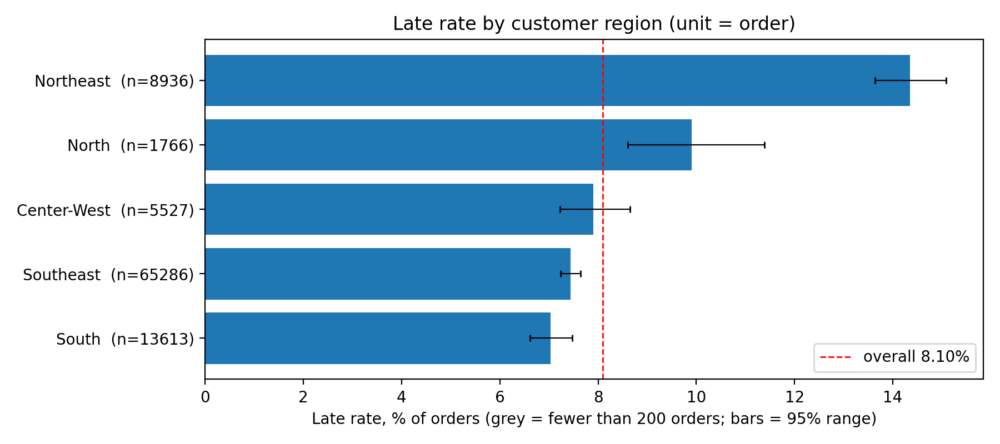

**Results by customer state** (27 states; selected rows, all rows in `customer_state_table.csv`)

| State | Orders | Late orders | Late rate | 95% range | Mean delivery days | Mean estimated window days | Mean freight per order |
|---|---|---|---|---|---|---|---|
| AL | 393 | 94 | 23.92% | 20.0-28.4 | 24.48 | 32.58 | R$ 38.68 |
| MA | 708 | 141 | 19.92% | 17.1-23.0 | 21.62 | 30.43 | R$ 43.02 |
| PI | 469 | 75 | 15.99% | 13.0-19.6 | 19.42 | 30.06 | R$ 43.05 |
| SE | 333 | 51 | 15.32% | 11.8-19.6 | 21.56 | 30.81 | R$ 41.04 |
| CE | 1,265 | 192 | 15.18% | 13.3-17.3 | 21.21 | 31.36 | R$ 36.53 |
| BA | 3,215 | 452 | 14.06% | 12.9-15.3 | 19.35 | 29.43 | R$ 29.85 |
| RJ | 12,169 | 1,641 | 13.49% | 12.9-14.1 | 15.31 | 26.39 | R$ 24.00 |
| SP | 39,951 | 2,343 | 5.86% | 5.6-6.1 | 8.76 | 19.14 | R$ 17.36 |
| MG | 11,188 | 631 | 5.64% | 5.2-6.1 | 12.02 | 24.55 | R$ 23.53 |
| PR | 4,855 | 243 | 5.01% | 4.4-5.7 | 11.98 | 24.61 | R$ 23.55 |
| RO | 238 | 7 | 2.94% | 1.4-5.9 | 19.47 | 38.80 | R$ 46.42 |

- All nine Northeast states are above the overall rate, from PE 10.72% to AL 23.92%, and each 95% range lies above 8.10%. The six highest states are all in the Northeast, followed by RJ (Southeast) at 13.49%.
- 15 of the 27 customer states have a 95% range entirely above 8.10%.
- Four customer states are flagged small (RR 39 orders, AP 67, AC 78, AM 144). Do not rank on them. RO has 238 orders but only 7 late ones.
- The far-North states have the longest estimated windows (RR 46.22 days, AP 46.24, AM 45.22, AC 41.21, RO 38.80, against SP 19.14 and AL 32.58). Their mean days against the estimate run from -16.75 to -20.18, so they arrive well before the estimate on average.

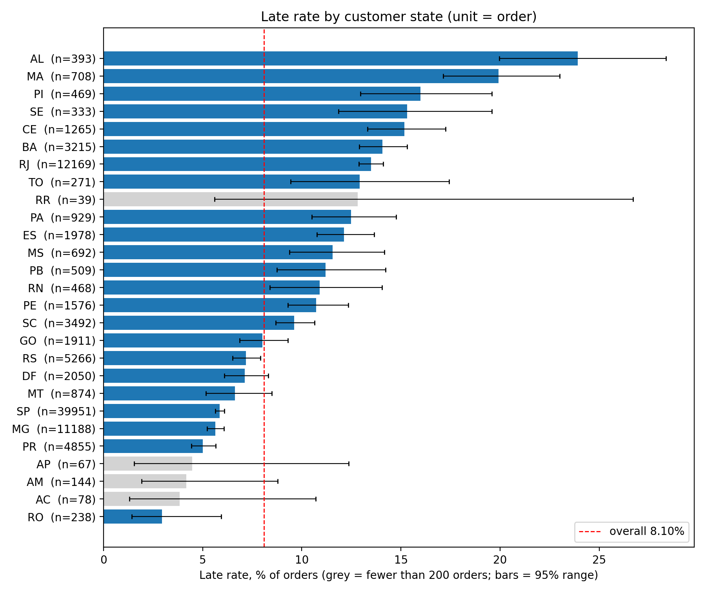

**Cross-state flag** (an order counts as cross-state if at least one item ships from a state other than the customer's; this is a flag, not a distance)

| Group | Orders | Late orders | Late rate | 95% range | Mean delivery days | Mean estimated window days | Mean days vs estimate | Mean freight per order |
|---|---|---|---|---|---|---|---|---|
| All items from the customer's own state | 34,083 | 2,067 | 6.06% | 5.8-6.3 | 7.94 | 17.55 | -9.61 | R$ 15.38 |
| At least one item from another state | 61,045 | 5,639 | 9.24% | 9.0-9.5 | 15.13 | 27.19 | -12.07 | R$ 26.97 |

Cross-state orders have a higher late rate, longer delivery times and also longer estimated windows. They arrive further before the estimate on average, while being late more often.

**Results by seller state** (94,632 orders with items from one seller state; selected rows, all 22 states in `seller_state_table.csv`)

| Seller state | Orders | Late orders | Late rate | 95% range | Mean delivery days | Mean estimated window days | Mean freight per order | Distinct sellers |
|---|---|---|---|---|---|---|---|---|
| SP | 67,233 | 5,900 | 8.78% | 8.6-9.0 | 12.36 | 22.78 | R$ 21.11 | 1,733 |
| MG | 7,407 | 426 | 5.75% | 5.2-6.3 | 12.96 | 25.51 | R$ 26.75 | 223 |
| PR | 7,297 | 481 | 6.59% | 6.0-7.2 | 13.48 | 26.78 | R$ 25.61 | 329 |
| RJ | 4,064 | 345 | 8.49% | 7.7-9.4 | 12.13 | 23.82 | R$ 21.60 | 160 |
| SC | 3,495 | 213 | 6.09% | 5.3-6.9 | 13.80 | 27.09 | R$ 29.05 | 180 |
| RS | 1,890 | 84 | 4.44% | 3.6-5.5 | 11.64 | 27.11 | R$ 28.84 | 122 |
| MA | 388 | 90 | 23.20% | 19.3-27.6 | 17.77 | 28.38 | R$ 31.04 | 1 |
| AM (small n) | 3 | 2 | 66.67% | 20.8-93.9 | 47.84 | 38.49 | R$ 27.27 | 1 |

- SP holds 71.0% of these orders (1,733 sellers); SP, MG and PR together hold 86.6%.
- 10 of the 22 seller states have fewer than 200 orders. RO (13 orders), PI (10) and SE (7) have 0 late orders, so no bar is drawn for them in the chart.
- MA has a 23.20% late rate on 388 orders, but all of them come from one seller, so this describes that seller, not the state. AM is 2 late orders out of 3.
- The 496 left-out orders from two or more seller states are late 0.81% of the time (4 orders), against 8.14% for the 94,632 kept. The reason is not known.

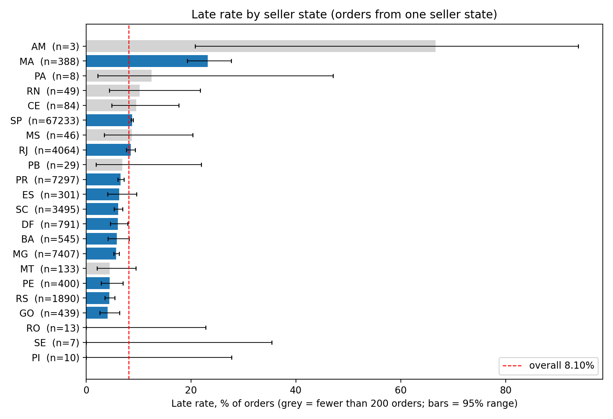

Reading the seller chart: grey bars have fewer than 200 orders. AM (3 orders) is the top bar and stretches the axis to 80%. The bars show the 95% range. The red line is the rate over all 95,128 orders (8.10%); the 94,632 orders in this chart have their own rate of 8.14%.

**What changed against the earlier notebook** (the earlier version counted rows and judged late on whole days; both changed here, so the table cannot say how much each change contributed)

| | Earlier (rows, whole days) | Now (orders, exact timestamps) |
|---|---|---|
| Overall late rate | 6.53% of 113,390 rows | 8.10% of 95,128 orders |
| North | 8.63% | 9.91% |
| Southeast | 5.87% | 7.44% |
| "Other" (Northeast, South and Center-West together) | 7.95% | 9.53% |

- The earlier notebook compared the North with the Southeast and put the other three regions into one "Other" group, which hid the Northeast (14.35%).
- The customer-state late rate is higher in 24 of 27 states and lower in SE (15.89% to 15.32%), PB (11.24% to 11.20%) and RO (4.00% to 2.94%).
- Freight per row became freight per order, which is a change of definition, not only of counting.
- In the earlier numbers AM had by far the highest seller-state delivery time (47.33 days), and it rested on 3 rows, which are 3 orders.
- The full side-by-side for every state is in `old_vs_new.csv`.

**Checks**
- The script stops if `order_id` is not unique (95,128 rows and 95,128 distinct orders), if the late flag rebuilt from the timestamps differs from the one in the order-level file, if a state is missing from the region map, if the customer-state, region or seller-state table does not add up to the order count, or if the Excel file and the order-level file hold different orders.
- Late orders add up to 7,706 in the customer-state, region and cross-state tables. The seller-state table has 94,632 orders and 7,702 late orders, and the 496 left-out orders hold the other 4.
- The earlier method was replayed on the same file and reproduced six numbers printed in the old notebook (113,390 rows, North 8.63%, Southeast 5.87%, AL 21.28%, SP seller rows 80,870, AM seller 47.33 days).

**Limits**
- Descriptive only. Customer state, region, cross-state flag and seller state overlap, so no table here separates one from another, and nothing says why a group is late more often.
- The cross-state flag is not a distance. This module does not measure distance.
- The 95% range assumes orders are independent. Orders from the same seller are not, so the seller-state ranges are too narrow, most of all where a state has few sellers (MA has one).
- Rates cover 2016-10 to 2018-08 as a whole. The late rate varies a lot by month (Module 1: 1.37% to 21.43%) and is not adjusted for it.
- The 200-order cut-off for small groups is a judgment call. RO (customer state) is above it with only 7 late orders.
- The 496 orders from two or more seller states are not in the seller-state table, and their low late rate is unexplained.
- No map is built in this module.

**Possible use:** these results show where the late rate is highest (Northeast customer states, and the one seller behind the MA seller state). A company could investigate whether estimated delivery windows are set too tight for the Northeast, or whether a single seller drives MA's rate. On average, Northeast orders arrive 10.64 days before the estimate. This module does not test either idea.

**Files:** `module2_geographic_logistics.py`, `requirements.txt`, `outputs/module2/` with `customer_state_table.csv`, `region_table.csv`, `cross_state_table.csv`, `seller_state_table.csv`, `old_vs_new.csv`, `customer_state_late_rate.png`, `region_late_rate.png`, `seller_state_late_rate.png`.

## Module 3: Category revenue (Pareto)

Folder: `Model3/`

**Question:** how concentrated is item price across the 73 product categories, and how many categories make up 80% of it?

**Approach**
- **Inputs:** `Brazilian-Ecommerce-Cleaned.xlsx` (113,390 rows) and `product_category_name_translation.csv` (71 rows, from the same Kaggle dataset). Both are copied into `Model3/data/` and are not in the repository. This module does not use the order-level table from Module 1.
- **The unit is the item.** One item is one `order_id` + `order_item_id`: 108,640 items. The file repeats an item once per payment, so the 113,390 rows are used only to replay the earlier method. All money below is summed once per item.
- **Revenue here means item price:** the `price` column summed over items, R$ 13,046,300.07. Freight (R$ 2,170,960.13) is left out of the headline and run as a check (price + freight = R$ 15,217,260.20). Neither is profit, and neither is the amount paid.
- **Categories:** 73 distinct categories, none missing, and each of the 31,625 products sits in exactly one category. An order can hold items from more than one category (724 of 95,128 orders, 0.76%); because money is counted per item, each item is counted once, in its own category.
- **Canceled orders** (6 orders, 7 rows in this file) are kept and not adjusted for.
- **English names:** the translation file has 71 rows. Two categories in the data are not in it, `pc_gamer` and `portateis_cozinha_e_preparadores_de_alimentos`; their English names (`pc_gamer`, `portable_kitchen_food_preparers`) were added by the author. Six names from the file were changed: five spelling fixes (for example `costruction_tools_garden` to `construction_tools_garden`) and `security_and_services` to `insurance_and_services`, because the Portuguese name is *seguros* (insurance). `translation_used.csv` lists every name with the original. Note that `computers` (Portuguese `pcs`) and `computers_accessories` are two different categories.
- **Pareto:** categories are sorted by item price and the cumulative share is added up. "80% is reached" at the first category where the cumulative share is 80% or more. The same is done for price + freight as a check.

**Results** (108,640 items, 73 categories, item price R$ 13,046,300.07)

- 17 categories reach 80%: the first 16 hold 79.05% (shown as 79.1% on the chart) and the first 17 hold 80.73%. That is 17 of 73 categories (23.3%). The 17th category is `computers`. The other 56 categories together hold about 19.3%.
- The five largest categories hold 40.36%, the ten largest 63.26%.

| Rank | Category | Item price (rounded, from the chart labels) | Items | Cumulative share of item price |
|---|---|---|---|---|
| 1 | health_beauty | R$ 1.23M | 9,464 | 9.45% |
| 2 | watches_gifts | R$ 1.17M | 5,857 | 18.39% |
| 3 | bed_bath_table | R$ 1.02M | 10,952 | 26.23% |
| 4 | sports_leisure | R$ 0.95M | 8,429 | 33.55% |
| 5 | computers_accessories | R$ 0.89M | 7,643 | 40.36% |

- Ranks 6 to 10 are furniture_decor, housewares, cool_stuff, auto and toys (chart below). All exact values are in `pareto_price_items.csv`.
- The ranking by price is not the ranking by items. Among the ten largest, bed_bath_table has the most items (10,952) but is third by price; watches_gifts is second by price with 5,857 items.
- The ten largest categories by price hold 69,180 of the 108,640 items (63.7%, printed by the script) and 63.26% of item price, so their share of price is close to their share of items. The first 17 hold 88,531 items (81.5%) against 80.73% of item price.
- **Freight check:** with price + freight (R$ 15,217,260.20) 17 categories also reach 80% (79.23% at 16, 80.88% at 17). The five largest are the same categories in the same order (39.77%) and the ten largest hold 63.20%. The two lists of 17 share 16 categories: `computers` is only in the price list and `pet_shop` only in the price + freight list. The count of 17 holds under both definitions; which category comes last does not.

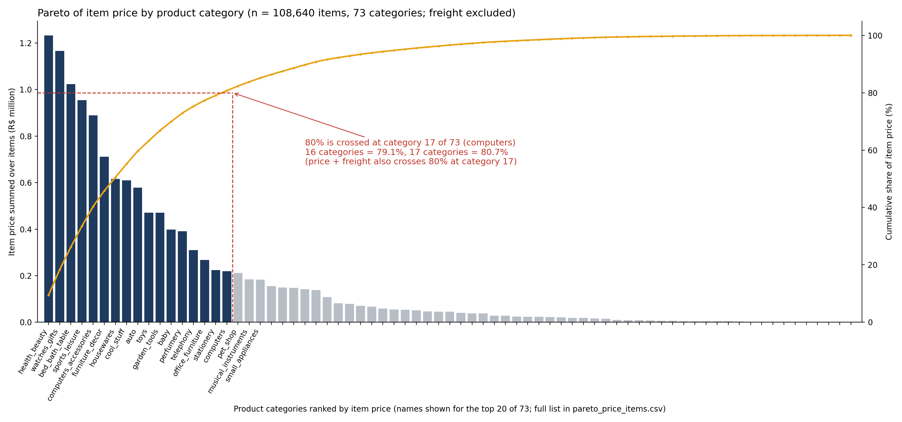

Reading the Pareto chart: bars use the left axis (R$ million); the amber line and the red 80% guides use the right axis (cumulative %). Dark bars are the first 17 categories. Names are shown for the top 20 only; the full list is in `pareto_price_items.csv`.

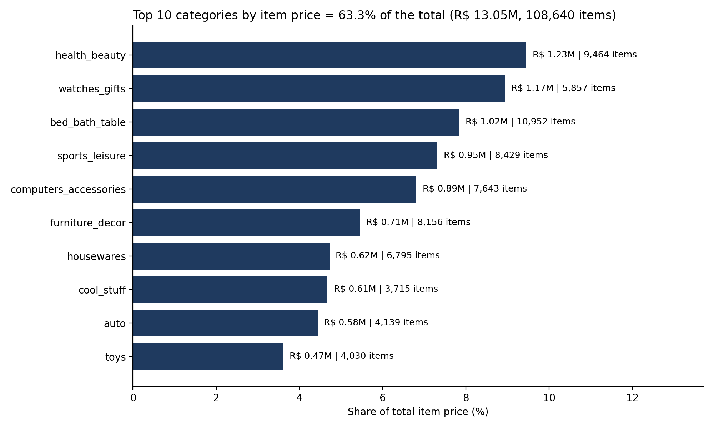

**What changed against the earlier notebook** (the earlier version summed price + freight over rows; both the unit and the revenue definition changed here)

| | Earlier (rows, price + freight) | Now (items) |
|---|---|---|
| Money unit | rows (113,390) | items (108,640) |
| Total price | R$ 13,627,670.23 | R$ 13,046,300.07 |
| Total freight | R$ 2,270,519.65 | R$ 2,170,960.13 |
| Revenue definition | price + freight | price only (price + freight as a check) |
| Five largest categories, cumulative share | 39.58% | 40.36% (price only); 39.77% (price + freight) |
| Categories needed for 80% | 17 (not reported in the earlier version) | 17 of 73 (price); 17 of 73 (price + freight) |

- The two changes can be separated here. Changing only the unit (price + freight, rows to items) moves the five-largest share from 39.58% to 39.77%. Changing the definition (price + freight to price only) moves it from 39.77% to 40.36%.
- Summing over rows overstates total price by 4.46% and total freight by 4.59%, because an item with several payments appears once per payment.
- The earlier version showed the Portuguese category names; this version uses English names.
- The headline did not change: the earlier method also reaches 80% at 17 categories.

**Checks** (only what the script asserts or prints)
- The script stops if the file does not have 113,390 rows; if price or freight differs between the payment rows of one item; if `order_unique_id` is not unique across the items; if the item count is not 108,640; if any category is missing; if the product count is not 31,625 or the category count is not 73; if a category has no English name or the English names are not one-to-one; if a product sits in two categories; or if the category totals do not add up to the total item price (within R$ 0.01).
- Printed, not asserted: the rows expected if every item repeats once per payment equal the actual 113,390 rows (MATCH); 724 of 95,128 orders contain items from more than one category; the replay of the earlier method reproduces its printed five-largest share of 39.58% (OK); the item counts of the ten largest and of the first 17 categories (69,180 and 88,531 of 108,640).

**Limits**
- Descriptive only. The module shows where item price sits, not why.
- Item price is the listed price per item. It is not profit and not the amount paid. For reference, payments over distinct payments total R$ 15,225,816.89 against R$ 15,217,260.20 for price + freight (both printed in `results_summary.txt`); this module does not reconcile the difference.
- The 80% mark is a convention. The first 16 categories already hold 79.05%, so the count of 17 depends on one small category, and the last category differs between price and price + freight.
- Concentration here is mostly a volume pattern: the ten largest categories by price hold about the same share of items as of price. The module does not separate volume from price level.
- The whole period (2016-10 to 2018-08) is pooled. Whether the ranking is the same in 2017 and in 2018 is not tested.
- The 6 canceled orders are not removed; they are at most 7 of the 108,640 items.
- Two English category names were added by the author and six were changed (see above); the original names are kept in `translation_used.csv`.

**Possible use:** showing which categories account for most of the item price, so that category-level checks (for example on stock, seller support or delivery times) could start with the 17 largest. This module does not test whether that would help.

**Files:** `module3_pareto.py`, `requirements.txt`, `outputs/module3/` with `pareto_price_items.csv` (one row per category: items, products, price, freight, price + freight, cumulative share), `pareto_price_plus_freight_items.csv`, `old_vs_new.csv`, `translation_used.csv`, `results_summary.txt`, `01_pareto_items.png`, `02_top10_categories.png`.

## Module 4: Monthly purchase trend

Folder: `Model4/`

**Question:** how did the number of orders per month change between January 2017 and August 2018, and can a yearly pattern be read from this data?

**Approach**
- **Input:** `Brazilian-Ecommerce-Cleaned.xlsx` (113,390 rows), copied into `Model4/data/` and not in the repository. This module reads nothing else and does not use the order-level table from Module 1.
- **The unit is the order.** An order is one distinct `order_id`, placed in the month of its `order_purchase_timestamp`. The file repeats an item once per payment: 113,390 rows, 108,640 items, 95,128 orders. Counting rows instead of orders would overstate the monthly count by 16% to 29% (rows per order run from 1.158 to 1.286 across the months in the window), and the gap is not constant. The script stops if the purchase timestamp or the order status differs between the rows of one order, so every order falls in exactly one month.
- **Months used:** the module uses the unbroken run of months, ending at the last month, in which every month has at least 100 orders. Oct 2016 has 268 orders, Nov 2016 has none and Dec 2016 has 1, so the run starts in Jan 2017: Jan 2017 to Aug 2018, 20 months, every month with at least 737 orders. That is 94,859 of the 95,128 orders; the 269 left out are from Oct to Dec 2016 (268 + 0 + 1). The 100-order rule is a judgment call, not a statistical rule.
- **Item price per month:** the `price` column summed once per item, in the purchase month of its order, freight excluded: 108,322 items and R$ 13,005,413.76 in the window (R$ 13,046,300.07 over all months). It is not profit and not the amount paid. It is shown next to the order counts, not instead of them.
- **No decomposition and no seasonal claim.** A yearly pattern needs at least two full years (24 months) and the window has 20. September to December each appear once, so the data cannot show whether the November rise repeats. The module gives three descriptive views instead: a monthly table, the same calendar month in 2017 and 2018, and orders per day in November 2017.
- **Kept, not changed:** the 6 canceled orders (1 of them in the window).

**Results by month** (94,859 orders in 20 months; item price counted once per item, freight excluded)

| Month | Orders | Change vs previous month | Item price |
|---|---|---|---|
| 2017-01 | 737 | n/a (first month in the window) | R$ 108,174.83 |
| 2017-02 | 1,592 | +116.0% | R$ 224,167.74 |
| 2017-03 | 2,496 | +56.8% | R$ 352,741.68 |
| 2017-04 | 2,243 | -10.1% | R$ 332,221.49 |
| 2017-05 | 3,466 | +54.5% | R$ 478,340.91 |
| 2017-06 | 3,085 | -11.0% | R$ 417,020.97 |
| 2017-07 | 3,824 | +24.0% | R$ 478,636.66 |
| 2017-08 | 4,129 | +8.0% | R$ 549,731.25 |
| 2017-09 | 4,090 | -0.9% | R$ 601,446.52 |
| 2017-10 | 4,428 | +8.3% | R$ 631,926.38 |
| 2017-11 | 7,186 | +62.3% | R$ 973,861.52 |
| 2017-12 | 5,383 | -25.1% | R$ 710,535.52 |
| 2018-01 | 6,901 | +28.2% | R$ 903,651.37 |
| 2018-02 | 6,451 | -6.5% | R$ 813,775.15 |
| 2018-03 | 6,884 | +6.7% | R$ 936,731.03 |
| 2018-04 | 6,731 | -2.2% | R$ 965,546.19 |
| 2018-05 | 6,716 | -0.2% | R$ 974,447.65 |
| 2018-06 | 6,075 | -9.5% | R$ 853,204.84 |
| 2018-07 | 6,118 | +0.7% | R$ 862,874.47 |
| 2018-08 | 6,324 | +3.4% | R$ 836,377.59 |

- Orders rose from 737 in Jan 2017 to 4,428 in Oct 2017. The rise was not steady: four months of 2017 were lower than the month before (Apr, Jun, Sep, Dec).
- Nov 2017 is the highest month by orders: 7,186, a unique maximum, 62.3% above Oct 2017. Dec 2017 is 5,383.
- In Jan to Aug 2018 the monthly count stays between 6,075 (Jun) and 6,901 (Jan), mean 6,525. Jan 2018 is 0.960 of Nov 2017. There is no rise from Jan to Aug 2018 in this data, and Aug 2018 may be understated (see Limits).
- Item price follows the order count through 2017. In Jan to Aug 2018 it stays between R$ 813,775.15 (Feb) and R$ 974,447.65 (May).
- **Which measure matters for the peak:** Nov 2017 has the most orders; May 2018 has the highest item price (R$ 974,447.65 against R$ 973,861.52 in Nov 2017, a difference of R$ 586.13, so the two are essentially tied). May 2018 reaches this with fewer orders (6,716 against 7,186) because item price per order was higher (R$ 145.09 against R$ 135.52). Item price per order stays between R$ 125.17 (Jul 2017) and R$ 148.11 (Apr 2017) across the window.
- **Per calendar day** (orders divided by the days of each month, in `monthly_table.csv`): Nov 2017 is the highest at 239.5; Jan to Aug 2018 runs from 197.4 (Jul) to 230.4 (Feb). Months differ in length, so this is a check on the monthly counts, not a different result.

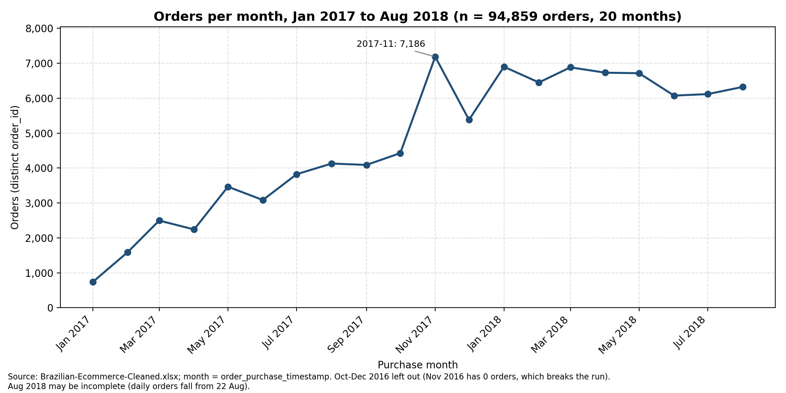

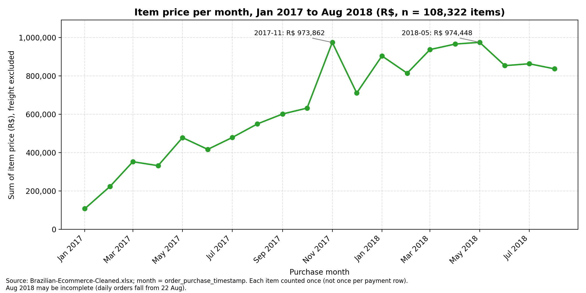

Reading the item price chart: both peaks are labelled because they are R$ 586.13 apart. Freight is excluded.

**Same calendar month, 2017 against 2018** (only Jan to Aug exist in both years; 21,572 orders in 2017, 52,200 in 2018, n = 73,772)

| Month | Orders 2017 | Orders 2018 | Difference | 2018 over 2017 |
|---|---|---|---|---|
| Jan | 737 | 6,901 | 6,164 | 9.36 |
| Feb | 1,592 | 6,451 | 4,859 | 4.05 |
| Mar | 2,496 | 6,884 | 4,388 | 2.76 |
| Apr | 2,243 | 6,731 | 4,488 | 3.00 |
| May | 3,466 | 6,716 | 3,250 | 1.94 |
| Jun | 3,085 | 6,075 | 2,990 | 1.97 |
| Jul | 3,824 | 6,118 | 2,294 | 1.60 |
| Aug | 4,129 | 6,324 | 2,195 | 1.53 |

- Every month of Jan to Aug 2018 has more orders than the same month of 2017. The ratio falls from 9.36 in Jan to 1.53 in Aug.
- The large ratios in early months are a base effect: early 2017 starts from a very small count (737 in Jan), while 2018 is roughly flat. The table shows that the ratio falls; it does not show why.

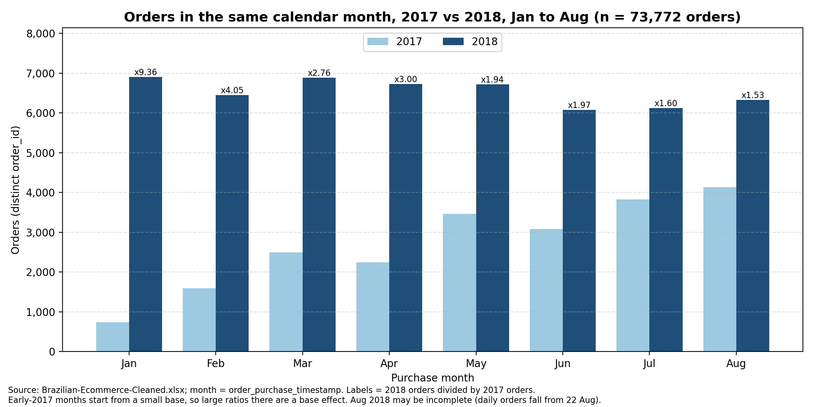

**Orders per day in November 2017** (7,186 orders on 30 days)

| Day | Orders |
|---|---|
| 2017-11-24 | 1,140 |
| 2017-11-25 | 480 |
| 2017-11-27 | 390 |
| 2017-11-26 | 376 |
| 2017-11-28 | 366 |

- 24 Nov alone holds 15.9% of the month's orders. The median day in November has 181 orders.
- Without 24 Nov, November averages 208.5 orders per day, against 142.8 in Oct 2017, 173.6 in Dec 2017 and 222.6 in Jan 2018 (orders divided by calendar days of each month). So the high November total is not only one day.
- 24 Nov 2017 was Black Friday by the calendar. The data has no promotion flag, so it shows when the orders were placed, not why.

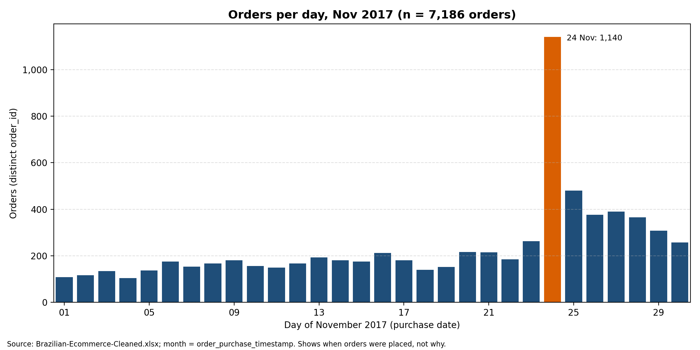

**What changed against the earlier notebook** (the earlier version counted rows and used a seasonal decomposition with a period of 6 that was chosen, not detected)

| | Earlier | Now |
|---|---|---|
| What is counted | rows (item x payment) | distinct orders |
| Total counted | 113,390 rows, 22 months | 94,859 orders, 20 months (95,128 orders in the table) |
| Months used | Oct 2016 to Aug 2018, with Nov 2016 missing | Jan 2017 to Aug 2018, unbroken, each month at least 100 orders |
| Nov 2017 | 8,683 rows | 7,186 orders |
| Method | seasonal decomposition, additive, period = 6 | no decomposition: monthly table, same month 2017 against 2018, daily check |
| Peak and trough month | May and June | no seasonal claim made |
| Trend statement | "upward" (last trend value above the first) | rise through 2017, then 6,075 to 6,901 orders a month in Jan to Aug 2018 |
| Money | not measured | item price per month, freight excluded |

- **The earlier peak and trough were not supported.** May and November were tied for the highest seasonal value (896.08), and June and December were tied for the lowest (-696.80). May and June were printed only because the code returns the first of equal values.
- **The "seasonal" panel repeated every 6 rows, not every 6 calendar months.** Rows 0, 6, 12 and 18 of the series (Oct 2016, May 2017, Nov 2017, May 2018) all receive the same seasonal value. With Nov 2016 missing, those rows are not 6 months apart.
- **The "upward" statement compared two numbers** (trend 1,789.17 at the start, 7,702.33 at the end, both counted in rows). It did not describe the flat part in 2018.
- **A yearly period cannot be fitted:** period = 12 on the 20-month window raises an error (24 observations are needed, there are 20).

**Checks** (only what the script asserts or prints)
- The script stops if the file does not have 113,390 rows, 108,640 items and 95,128 orders; if the purchase timestamp or the order status differs between the rows of one order; if `order_id` or the item id is not unique in its table; if the item price total is not R$ 13,046,300.07; if the last month has fewer than 100 orders; if the window is not Jan 2017 to Aug 2018 with 20 months, 94,859 orders and 108,322 items; or if the monthly rows and orders do not add up to 113,390 and 95,128.
- Printed, not asserted: 94,859 orders in the window plus 269 left out equal the 95,128 orders in the table; the highest month by orders (2017-11) is unique (True); the 6 orders with a status other than "delivered" all have the status "canceled" (1 in the window).
- The replay of the earlier method prints OK when it matches the earlier printed values: 113,390 rows, 8,683 rows in Nov 2017, the first and last trend values (1,789.17 and 7,702.33) and the peak and trough (May, June). It also prints the tie of May and November (896.08) and of June and December (-696.80), and the error for period = 12 on 20 months.

**Limits**
- Descriptive only. The module shows when orders were placed, not why. No cause is tested.
- The window is 20 months. No yearly pattern can be estimated, and the data cannot say whether the Nov 2017 peak would repeat.
- **Aug 2018 may be incomplete.** Daily orders fall from 22 Aug: the last 10 days present are 249, 238, 184, 142, 96, 69, 72, 65, 39 and 11, against a median of 247 for the month. The last purchase is on 2018-08-29. The cause is not tested, so Aug 2018 (6,324 orders) and its ratio of 1.53 may be too low.
- The early-2017 ratios (9.36, 4.05) come from a very small base.
- 24 Nov 2017 is Black Friday by the calendar only. The data has no promotion flag.
- Item price is the listed price per item. It is not profit, not the amount paid, and freight is excluded. Money is in R$ and is not adjusted for anything.
- Oct to Dec 2016 (269 orders) are left out because Nov 2016 has no orders and breaks the run. The 100-order rule is a judgment call.
- The 6 canceled orders are kept, not adjusted for.

**Possible use:** seeing how order volume moved over the period and how much a single day can add (1,140 orders on 24 Nov 2017 against a median day of 181 in that month). A company could check whether support and delivery capacity were sized for single-day peaks like this one. This module does not test that.

**Files:** `module4_purchase_trend.py`, `requirements.txt`, `outputs/module4/` with `monthly_table.csv`, `yoy_jan_aug.csv`, `nov2017_daily.csv`, `old_vs_new.csv`, `results_summary.txt`, `01_orders_per_month.png`, `02_same_month_2017_vs_2018.png`, `03_orders_per_day_nov2017.png`, `04_item_price_per_month.png`.

## Module 5: Payment-behaviour segments

Folder: `Model5/`

**Question:** can customers be grouped by how much they paid and how they paid (instalments, item price, freight), and what do the groups look like?

**Approach**
- **Input:** `Brazilian-Ecommerce-Cleaned.xlsx` (113,390 rows), copied into `Model5/data/` and not in the repository. 10 columns are read: `order_id`, `order_item_id`, `customer_id`, `customer_unique_id`, `payment_sequential`, `payment_type`, `payment_installments`, `price`, `freight_value`, `payment_value`. None has a missing value (asserted). This module does not use the order-level table from Module 1.
- **Units.** 113,390 rows hold 108,640 items (`order_id` + `order_item_id`), 99,329 payments (`order_id` + `payment_sequential`), 95,128 orders and 92,081 customers (`customer_unique_id`). In this file `customer_id` is one per order (95,128 distinct, asserted), so it is not used as a customer. An order belongs to one `customer_unique_id` (asserted).
- **Money here is the amount paid, not item price.** It is `payment_value` counted once per payment: R$ 15,225,816.89 over 99,329 payments (asserted). Summing it over all 113,390 rows would give R$ 19,530,503.34, which is 28.3% more. Modules 3 and 4 use item price (R$ 13,046,300.07 once per item); Module 3 reports R$ 15,217,260.20 for price + freight once per item. These are different measures and are not reconciled here.
- **Four features per customer**, all counted once per payment or once per item: total paid (sum of the customer's payments), average instalments per payment, average item price (per item) and average freight (per item). A customer with several orders has all orders combined. The customer table has 92,081 unique rows, its total paid adds up to R$ 15,225,816.89 and its orders add up to 95,128 (all asserted).
- **Payment type is not a feature.** The groups are built from the four numbers above; payment type is only profiled afterwards.
- **Method:** the four features are standardised (StandardScaler, no other transformation) and grouped with K-Means (10 starts, seed 42). The data are skewed, so means and medians are both shown.
- **Choosing k:** k = 2 to 10 on a sample of 10,000 customers drawn without repeats (seed 42); the k with the highest silhouette is used. k = 2 is also the smallest value tested. The k range and the seed are the same as in the earlier version.
- **Final model:** fitted on all 92,081 customers, with clusters numbered so that cluster 0 has the lower mean total paid. The silhouette of the final model is computed on a 20,000-customer sample (seed 42), because the full calculation on 92,081 customers is slow (a setting in the script, `FULL_SILHOUETTE`, switches it).
- **Payment mix:** each payment is assigned to the cluster of its customer, so the mix is a share of payments (n = 99,329), not of customers.

**Customers and orders**

| Orders per customer | Customers | Share of customers |
|---|---|---|
| 1 order | 89,340 | 97.0% |
| 2 orders | 2,520 | 2.7% |
| 3 or more orders (maximum 14) | 221 | 0.2% |

This is mostly a one-order view of each customer. Per customer, total paid has a median of R$ 107.78, a mean of R$ 165.35, a 99th percentile of R$ 1,095.80 and a maximum of R$ 13,664.08 (1 order, 8 items, 1 payment).

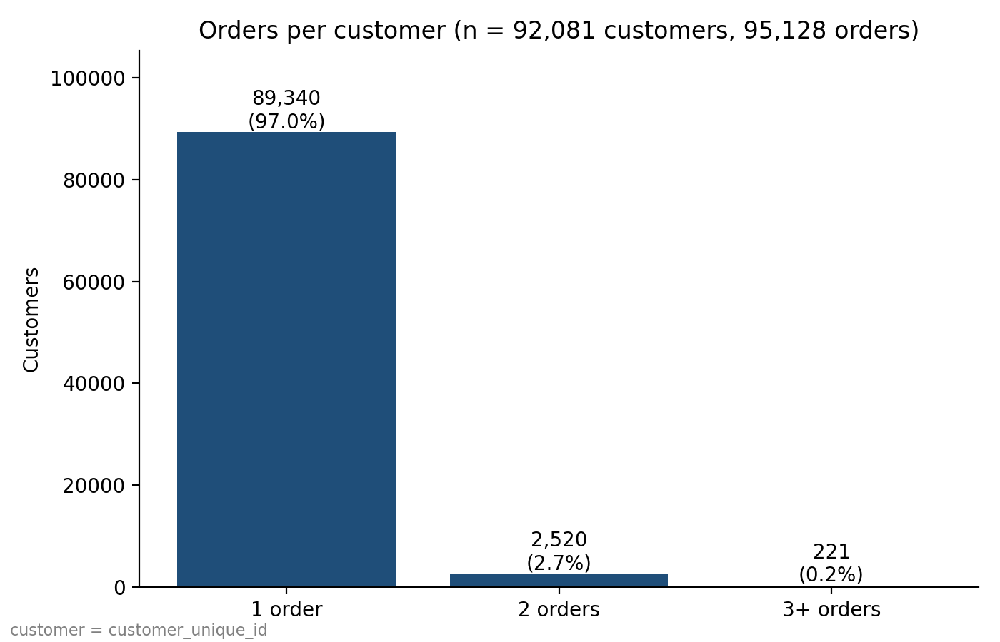

**Choosing k** (10,000 customers sampled without repeats, 4 scaled features)

| k | Inertia | Silhouette |
|---|---|---|
| 2 | 27,081 | 0.7395 |
| 3 | 19,677 | 0.5325 |
| 4 | 16,092 | 0.5235 |
| 5 | 13,333 | 0.5269 |
| 6 | 11,484 | 0.5198 |
| 7 | 10,067 | 0.4267 |
| 8 | 8,910 | 0.3918 |
| 9 | 8,092 | 0.4012 |
| 10 | 7,475 | 0.3930 |

- The silhouette is highest at k = 2 (0.7395), so k = 2 is used. It falls to 0.52-0.53 for k = 3 to 6 and to 0.39-0.43 for k = 7 to 10.
- Inertia falls steadily as k rises, so the elbow plot does not point to one k.

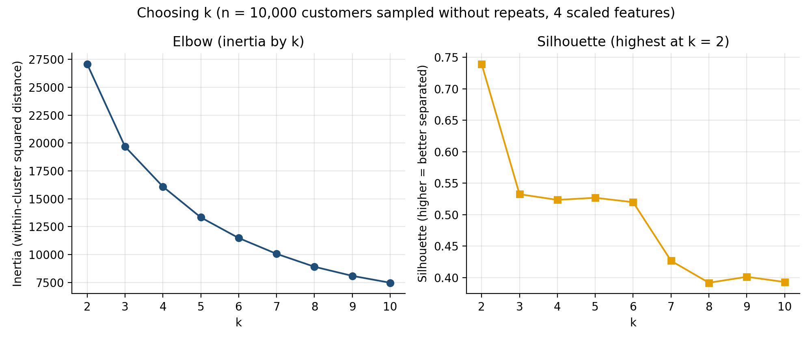

**Results: the two clusters** (n = 92,081 customers; total paid is the amount paid, per customer)

| Per customer | Cluster 0 | Cluster 1 |
|---|---|---|
| Customers | 87,300 (94.8%) | 4,781 (5.2%) |
| Total paid, mean | R$ 129.10 | R$ 827.40 |
| Total paid, median | R$ 102.32 | R$ 669.40 |
| Instalments per payment, mean | 2.71 | 6.47 |
| Instalments per payment, median | 1.33 | 8.00 |
| Item price, mean | R$ 95.40 | R$ 682.63 |
| Item price, median | R$ 72.99 | R$ 579.00 |
| Freight per item, mean | R$ 18.34 | R$ 54.53 |
| Freight per item, median | R$ 16.12 | R$ 41.43 |

- Cluster 1 is a small group (5.2% of customers) with higher total paid, higher item price, higher freight and more instalments per payment than cluster 0 on every measure shown, in mean and in median.
- The silhouette of the final model is 0.7164 (on a 20,000-customer sample of the 92,081).
- The two features drawn in the scatter chart overlap between the clusters; the split also uses item price and freight, which are not drawn. Cluster 1 is drawn on top of cluster 0, so some overlap is hidden. Rows of points at whole numbers of instalments are expected, because one payment has a whole number of instalments.

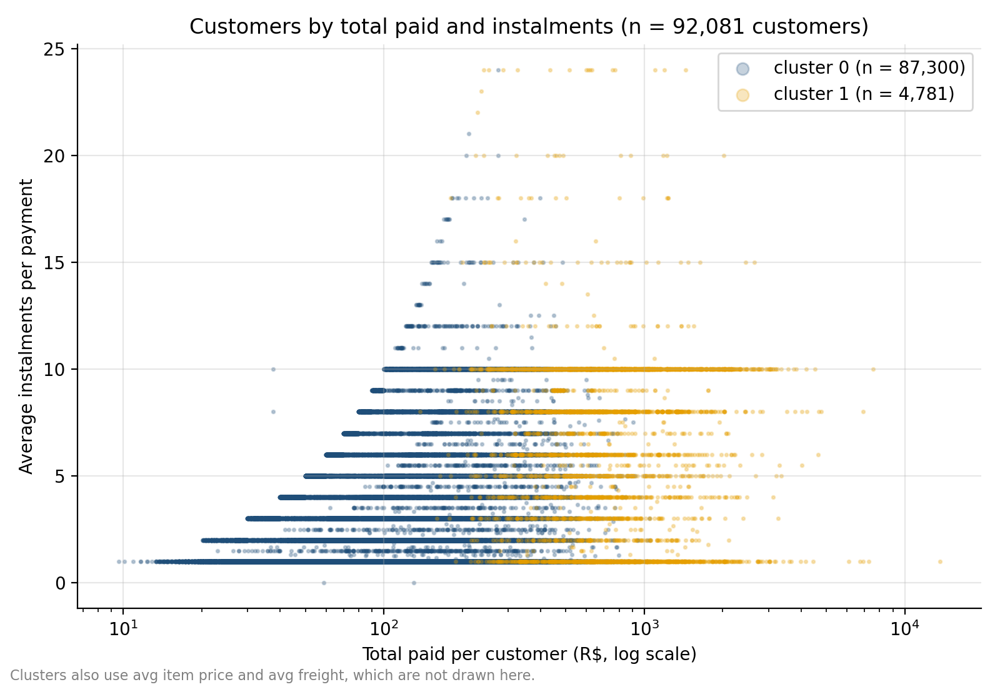

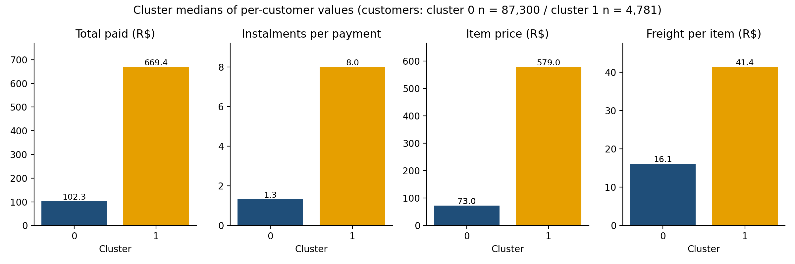

**Payment type by cluster** (share of payments, n = 99,329 payments; payment type was not a clustering input)

| Cluster | Payments | boleto | credit card | debit card | voucher |
|---|---|---|---|---|---|
| 0 | 94,083 | 19.5% | 73.5% | 1.5% | 5.5% |
| 1 | 5,246 | 11.9% | 83.3% | 0.8% | 4.1% |

- Credit card is the most common payment type in both clusters (73.5% and 83.3% of payments). Boleto is 19.5% of payments in cluster 0 and 11.9% in cluster 1. Rows add to 100% apart from rounding. No test was run on these differences.
- Instalments above 1 occur only on credit-card payments: boleto, debit card and voucher payments all have exactly 1 instalment (printed). So the average instalments of a customer depend partly on how many of their payments were by credit card.

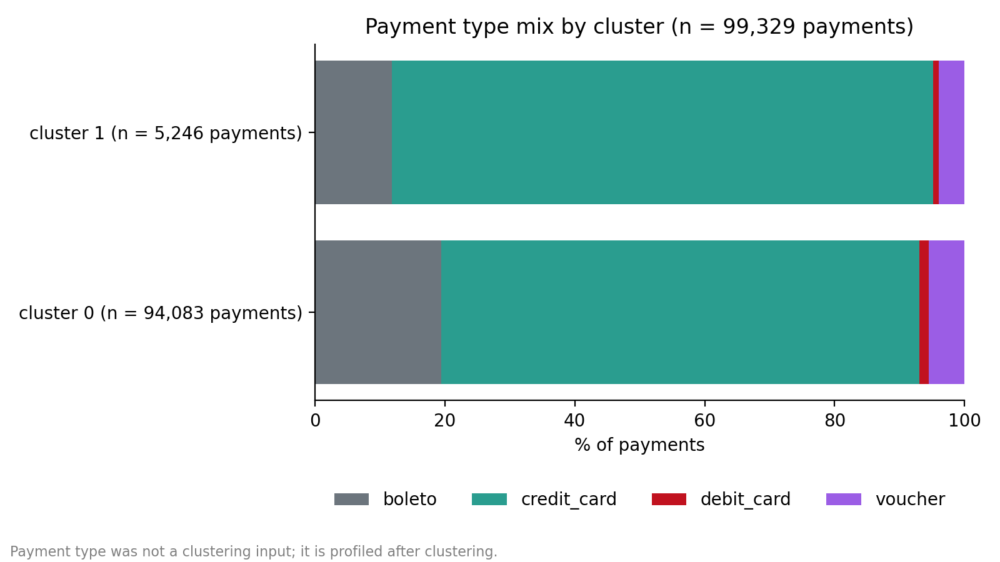

**What changed against the earlier notebook** (the earlier version clustered `customer_id` and summed money over rows; the unit, the counting and the sampling changed together, so the table cannot say how much each change contributed)

| | Earlier | Now |
|---|---|---|
| What is called a customer | `customer_id` (one per order) | `customer_unique_id` |
| Units clustered | 95,128 | 92,081 customers |
| Total paid used | R$ 19,530,503.34 (`payment_value` summed over rows) | R$ 15,225,816.89 (once per payment) |
| Largest single total | R$ 109,312.64 | R$ 13,664.08 |
| Sample used to choose k | 10,000 with repeats | 10,000 without repeats |
| k chosen (highest silhouette) | 2 | 2 |
| Silhouette on the sample at k = 2 | 0.5923 | 0.7395 |
| Silhouette of the final model | 0.5833 (all 95,128 units; value printed by the earlier version, not recomputed here) | 0.7164 (20,000-customer sample) |
| Cluster sizes (lower total first) | 78,661 and 16,467 | 87,300 and 4,781 |
| Correlation, instalments with payment amount | 0.2743 (113,390 rows) | 0.3325 (99,329 payments); Spearman 0.4119 |

- The earlier version also averaged instalments, item price and freight over rows, not over payments or items.
- The earlier maximum of R$ 109,312.64 is exactly 8 x R$ 13,664.08, and the largest customer now has 1 payment and 8 items, which fits one payment being repeated on 8 item rows.
- **The silhouette scores must not be read as an improvement.** The unit, the features' counting, the sample and the clusters all differ, so 0.74 and 0.72 are not comparable with 0.59 and 0.58.
- The small group was 16,467 of 95,128 units (17.3%) earlier and is 4,781 of 92,081 customers (5.2%) now. The two groups are not the same groups.
- The four features of the earlier version contain no payment type either (the replay below reproduces its printed numbers from those four features). Payment type is only profiled after clustering, as above.

**Checks** (only what the script asserts or prints)
- The script stops if the file does not have 113,390 rows, 108,640 items, 99,329 payments, 95,128 orders (and 95,128 distinct `customer_id`) and 92,081 customers; if an order has two `customer_unique_id`; if payment columns differ inside one payment or price and freight inside one item; if a used column has a missing value; if the payment total is not R$ 15,225,816.89; if the customer table does not have 92,081 unique rows, adds up to a different money total or to a different order count; or if the 10,000-customer sample for choosing k has repeats.
- Printed, not asserted: the earlier method, replayed on the same file, matched the values printed by the earlier version (OK on every line): cluster sizes 16,467 and 78,661, mean total spend R$ 135.80 and R$ 537.32, silhouettes for k = 2 to 10 (within 0.0005) and the correlation 0.2743.
- Re-running the final model with 5 other random starts (seeds 0 to 4) gave the same two sizes (87,300 and 4,781) and an adjusted Rand agreement of 1.0000 with the main run each time. This checks the random start only, not other data.
- With the single largest customer removed and the features rescaled, the sizes are 4,699 and 87,381 against 4,781 and 87,300.
- For reference only (not used): k = 3 on all customers gives sizes 70,808, 19,267 and 2,006 (mean total paid R$ 109.88, R$ 259.15 and R$ 1,222.63). Its silhouette, 0.5247, is on a 20,000-customer sample, like the final model's.

**Limits**
- Descriptive only. The clusters are a statistical split of four numbers, not a validated segmentation, and nothing here says why a customer is in a cluster.
- k = 2 gives a small higher-spend group and everyone else. It is not a split by payment type, and 97.0% of customers placed one order.
- Silhouette measures separation only; it says nothing about usefulness. The silhouette values come from different samples (10,000 and 20,000 customers) and from different data than the earlier version, so they are not compared with each other as a ranking of methods.
- Total paid and average item price move together (Pearson r = 0.903 over 92,081 customers; total paid with average freight 0.454), and cluster 1 is higher on all four features. This module cannot separate spend from item price.
- Total paid is skewed (median R$ 107.78, maximum R$ 13,664.08) and K-Means on standardised skewed data is sensitive to large values; the result changes a little when the largest customer is removed (see Checks).
- Credit-card payments run from 0 to 24 instalments in this file (printed minimum 0); how many payments have 0 is not printed, and they are kept as they are.
- The payment-type shares are shares of payments, and a customer can use several payment types.
- One dataset, 2016-10 to 2018-08.

**Possible use:** grouping customers by spend and instalment habits for descriptive reporting, for example to look at how the small higher-spend group differs from the rest in instalments and freight. This module does not test whether such a grouping would help.

**Files:** `model5_payment_behaviour.py`, `requirements.txt`, `outputs/model5/` with `cluster_profile.csv`, `k_search.csv`, `old_vs_new.csv`, `01_orders_per_customer.png`, `02_choosing_k.png`, `03_segments_scatter.png`, `04_cluster_profiles_median.png`, `05_payment_mix_by_cluster.png`.

## Power BI dashboard

Folder: `PowerBI/`

**What it is:** a two-page Power BI report on the same dataset: `Product Analytics` (page 1) and `Customer Analytics` (page 2). Both pages have two slicers, `year_of_purchase` and `customer_state`. The screenshots below were taken with both slicers on All and nothing selected or cross-filtered. The report file itself is not published, because it contains a copy of the cleaned data; only the screenshots are in this repository. The dashboard is descriptive only; no model is used and no cause is tested.

**What changed against the earlier dashboard** (the sample and the definitions changed together, so the table cannot say how much each change contributed)

| | Earlier | Now |
|---|---|---|
| Rows used | 30,000-row sample | all 113,390 rows |
| Total Orders | 28,127 | 95,128 |
| Total Revenue | R$ 4,207,908.04 | R$ 15,217,260.20 |
| Average Order Value | R$ 149.60 | R$ 159.97 |
| Late rate | about 7% (late judged on whole days, per row) | 8.10% (exact timestamps, per order) |
| Avg Delivery Days | 11.97 | 12.09 |
| Avg Delay Days | 9.18 | 8.87 |
| Avg Freight per Item | R$ 19.91 | R$ 19.98 |
| Load step | included a random forest | removed |

**How the numbers are counted**
- The dashboard table has 113,390 rows (checked after the Python step), the same row count as the cleaned working file. The measures do not count rows: Total Orders counts distinct orders (95,128), and money is counted once per item.
- **Total Revenue is price + freight, counted once per item: R$ 15,217,260.20.** For each row, price + freight is divided by the number of payment rows of the same item, so an item that appears once per payment adds its price + freight only once in total. It is not the item price used as the headline in Module 3 (R$ 13,046,300.07, price only), and it is not profit and not the amount paid (R$ 15,225,816.89 in Module 5). Summing price + freight over all 113,390 rows would give R$ 15,898,189.88.
- Power BI shows money with Indian digit grouping (R$ 15,217,260.20 appears as 1,52,17,260.20). This README writes the same numbers with the grouping used everywhere else.
- **Late** uses the project definition (delivered after the estimated delivery time, exact timestamps): 7,706 of 95,128 orders = 8.10%, the same as Modules 1 and 2. In Power BI it is the column `is_late`, a DAX calculated column: `IF(order_delivered_customer_date > order_estimated_delivery_date, 1, 0)`. It is not built in Power Query or in the Python step.
- **The dashboard's delivery days are whole days** (Avg Delivery Days, Avg Delay Days, processing and shipping time). A whole day is the day part of the time difference, so 30 hours counts as 1 and 12 hours counts as 0. Module 2 uses exact timestamp differences with fractions. Do not compare the two directly. Avg Delay Days averages `delay_days` once per late order, where `is_late` = 1, so an order late by under 24 hours counts as late (it is in the 8.10%) and adds 0 days to the average of 8.87.
- **Load step (Power Query):** the applied steps are Source, Navigation, Changed Type (column data types), Run Python script, df (the script's output table) and Changed Type1 (data types set again after the script). The cleaned Excel file (113,390 rows, 34 columns) goes in. The script converts four date columns (`order_purchase_timestamp`, `order_approved_at`, `order_delivered_customer_date`, `order_estimated_delivery_date`) to dates and adds five columns: `delay_days` (delivered minus estimated), `delivery_days` (purchase to delivered), `processing_time` (purchase to approved), `shipping_time` (approved to delivered), each in whole days, and `distance_proxy` (1 if seller state differs from customer state, otherwise 0). It then drops rows with a missing value in the four day columns; none were dropped, so 113,390 rows remain, now with 39 columns. `distance_proxy` is not used in any visual.
- **Data types and null values** were checked earlier, in Excel's Power Query, on the cleaned working file. Power BI does not repeat that check.
- Category names are the original Portuguese. The five largest by Total Revenue are beleza_saude (health_beauty), relogios_presentes (watches_gifts), cama_mesa_banho (bed_bath_table), esporte_lazer (sports_leisure) and informatica_acessorios (computers_accessories). These are the same five categories in the same order as in Module 3, which also found the same top five when freight is added.
- All eight card values were compared with a separate pandas calculation and match.

### Page 1: Product Analytics

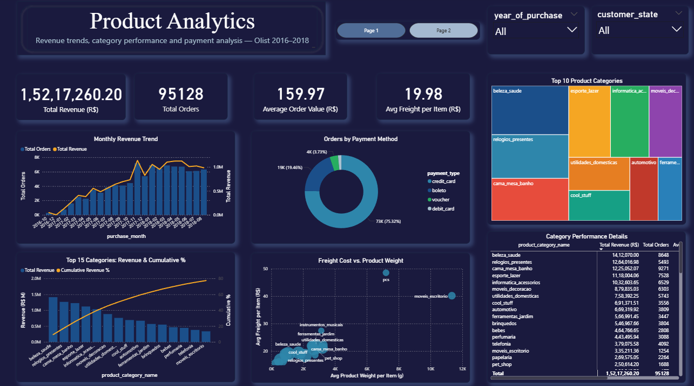

| Card | Value | How it is counted |
|---|---|---|
| Total Revenue (R$) | R$ 15,217,260.20 | price + freight, once per item |
| Total Orders | 95,128 | distinct orders |
| Average Order Value (R$) | R$ 159.97 | Total Revenue divided by Total Orders |
| Avg Freight per Item (R$) | R$ 19.98 | freight over items (R$ 2,170,960.13 over 108,640 items) |

Visuals:
- **Monthly Revenue Trend:** bars show Total Orders and the line shows Total Revenue for each purchase month, 2016-10 to 2018-08. 2016-11 has no orders and does not appear on the axis. The 2016 months are tiny (268 orders in Oct 2016, 1 in Dec 2016).
- **Orders by Payment Method:** a donut of orders that used each payment type. Labelled on the chart: credit_card 75.32%, boleto 19.46%, voucher 3.73%. The debit_card slice is not labelled.
- **Top 10 Product Categories:** a treemap of the ten categories with the highest Total Revenue.
- **Top 15 Categories: Revenue & Cumulative %:** bars show Total Revenue by category and the line shows the cumulative share on the right axis. The line reaches 77.46% at the 15th category (moveis_escritorio), as a share of the total of all categories. Module 3's price + freight check gives 79.23% at 16 categories and 80.88% at 17.
- **Freight Cost vs Product Weight:** one dot per category, for the 20 categories with the highest Total Revenue; x is average product weight per item (g), y is average freight per item (R$). The `pcs` dot (computers) rests on 177 orders, so it should not be read as a pattern.
- **Category Performance Details:** one row per category with Total Revenue, Total Orders and Average Order Value, sorted by Total Revenue. The top five rows:

| Category | Total Revenue | Total Orders |
|---|---|---|
| beleza_saude | R$ 1,412,070.00 | 8,648 |
| relogios_presentes | R$ 1,264,016.98 | 5,493 |
| cama_mesa_banho | R$ 1,225,052.07 | 9,271 |
| esporte_lazer | R$ 1,118,004.06 | 7,528 |
| informatica_acessorios | R$ 1,032,603.65 | 6,529 |

The Total row shows R$ 15,217,260.20 and 95,128 orders.

Reading page 1:
- **Orders per category do not add to 95,128.** An order with items from two categories counts in both. 724 orders have items from more than one category (Module 3), so the category Total Orders add to slightly more than 95,128. The Total row counts each order once.
- **The payment donut counts orders per payment type.** An order paid with two payment types counts under both (2,148 orders used two or more). The shares are shares of this combined count, not of 95,128 orders. Module 5's payment shares are shares of payments, a different base.
- Revenue per category is price + freight, so it differs from the item price in Module 3's tables.

### Page 2: Customer Analytics

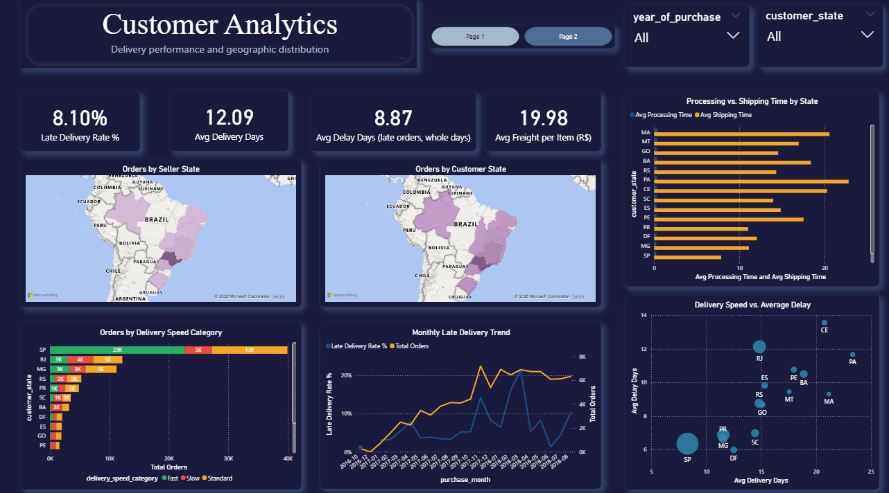

| Card | Value | How it is counted |
|---|---|---|
| Late Delivery Rate % | 8.10% | 7,706 late orders of 95,128 |
| Avg Delivery Days | 12.09 | whole days, per order |
| Avg Delay Days (late orders, whole days) | 8.87 | late orders only |
| Avg Freight per Item (R$) | R$ 19.98 | same as page 1 |

Visuals:
- **Orders by Seller State** and **Orders by Customer State:** maps shaded by Total Orders, so the second one shows orders by customer state, not a count of customers. The maps have no legend, so no values can be read from the image; São Paulo (SP) is the darkest state on both. The 496 orders with items from two or more seller states (Module 2) are counted in every state they have items from.
- **Processing vs. Shipping Time by State:** average processing time and average shipping time (whole days) for the 15 customer states with the most orders. Processing time is rounded down to whole days, so its bars sit near 0. The chart scrolls; the screenshot shows 14 of the 15 states (RJ is below the visible part).
- **Orders by Delivery Speed Category:** orders by customer state (the same 15 states), split into Fast (green), Standard (orange) and Slow (red). The chart scrolls; the screenshot shows 11 of the 15 states.
- **Monthly Late Delivery Trend:** late rate % (line) and Total Orders (line) by purchase month. The late rate swings from month to month (Module 1 gives 1.37% in Jun 2018 and 21.43% in Mar 2018). The 2016 points rest on 269 orders in total.
- **Delivery Speed vs. Average Delay:** one bubble per state for the same 15 states, sized by Total Orders; x is average delivery days (whole days), y is average delay days (late orders only).

Reading page 2:
- **`delivery_speed_category` is a threshold chosen by the author, not a Kaggle field:** Fast is 7 whole days or less, Standard is 8 to 14, Slow is 15 or more. "Slow" does not mean "late". A slow order can still arrive before its estimated date, and the estimated window differs by state (Module 2).
- **Avg Delay Days uses late orders only.** A state with few late orders has an average that rests on few orders.
- The dashboard does not mark states with few orders. Module 2 flags states with fewer than 200 orders; use Module 2 when ranking states.

**Limits**
- Descriptive only. The dashboard shows how the numbers differ between years, states and categories, not why.
- Dashboard numbers and module numbers differ where the definitions differ: revenue (price + freight against item price), days (whole days against exact timestamps), and the base of the payment shares.
- Date and state slicers change every visual on a page; the numbers above are for All.
- The dashboard is shown as two screenshots. The report file is not published, so the visuals cannot be filtered or refreshed from this repository.

**Possible use:** using the two slicers to compare one purchase year or one customer state with the whole, for example to see which states have the highest late rate and the longest shipping time before looking at them in Module 2. This dashboard does not test any decision.

**Files:** `PowerBI/page1_product_analytics.png`, `PowerBI/page2_customer_analytics.png`.

## Repository structure

```
Olist_ECommerce_Analytics/
├── README.md
├── .gitignore
├── Model1/                         Late-delivery risk
│   ├── 01_build_order_table.py
│   ├── 02_payment_checks.py
│   ├── 03_model1_late.py
│   ├── requirements.txt
│   └── outputs/
│       ├── model1_report.txt
│       ├── cleaning_log.txt
│       ├── payment_checks.txt
│       ├── flagged_payment_orders.csv
│       └── tables/                 7 CSV files
├── Model2/                         Geographic logistics
│   ├── module2_geographic_logistics.py
│   ├── requirements.txt
│   └── outputs/module2/            4 tables, old_vs_new.csv, 3 charts
├── Model3/                         Category revenue (Pareto)
│   ├── module3_pareto.py
│   ├── requirements.txt
│   └── outputs/module3/            2 charts, 4 CSV files, results_summary.txt
├── Model4/                         Monthly purchase trend
│   ├── module4_purchase_trend.py
│   ├── requirements.txt
│   └── outputs/module4/            4 charts, 4 CSV files, results_summary.txt
├── Model5/                         Payment-behaviour segments
│   ├── model5_payment_behaviour.py
│   ├── requirements.txt
│   └── outputs/model5/             5 charts, 3 CSV files
└── PowerBI/
    ├── page1_product_analytics.png
    └── page2_customer_analytics.png
```

**Not in the repository** (the `.gitignore` keeps them out): the data files (the dataset, the cleaned Excel file, `olist_order_level.csv` and the copies in each module's `data/` folder), the Power BI report file, and `Model1/models/`, which script 03 creates again each time it runs.

Each module is self-contained: its own script, its own `requirements.txt` and its own `outputs/` folder. Module 2 needs the order-level table that Module 1 builds.

## How to run

All commands are run from the repository root in PowerShell. Tested with Python 3.13.9.

**1. Get the data.** No data files are in this repository. Download the dataset from Kaggle (link in [Data](#data)) and build `Brazilian-Ecommerce-Cleaned.xlsx` as described there. Module 3 also needs `product_category_name_translation.csv` from the same Kaggle dataset.

**2. Put the files in each module's `data/` folder.** Each script reads from its own `ModelN/data/` folder. Create it if it does not exist.

| Module | Files in its `data/` folder |
|---|---|
| Model1 | `Brazilian-Ecommerce-Cleaned.xlsx` (script 01 then creates `olist_order_level.csv` here) |
| Model2 | `Brazilian-Ecommerce-Cleaned.xlsx`, `olist_order_level.csv` (copy it from `Model1/data/` after step 3) |
| Model3 | `Brazilian-Ecommerce-Cleaned.xlsx`, `product_category_name_translation.csv` |
| Model4 | `Brazilian-Ecommerce-Cleaned.xlsx` |
| Model5 | `Brazilian-Ecommerce-Cleaned.xlsx` |

**3. Install and run, one module at a time.** Each module has its own `requirements.txt`. Run Module 1 first and in this order, because Module 2 needs the table it builds.

```
pip install -r Model1\requirements.txt
python Model1\01_build_order_table.py
python Model1\02_payment_checks.py
python Model1\03_model1_late.py

pip install -r Model2\requirements.txt
python Model2\module2_geographic_logistics.py

pip install -r Model3\requirements.txt
python Model3\module3_pareto.py

pip install -r Model4\requirements.txt
python Model4\module4_purchase_trend.py

pip install -r Model5\requirements.txt
python Model5\model5_payment_behaviour.py
```

Results are written to each module's `outputs/` folder. Module 1 also saves its fitted model to `Model1/models/`. `01_build_order_table.py`, `03_model1_late.py` and the scripts of Modules 2 to 5 stop with a message if an expected count does not match (for example 95,128 orders). `02_payment_checks.py` only reads the data and reports; it does not change anything.

The Power BI dashboard is not run from this repository; only its two screenshots are published.

## Limitations

- **Descriptive, not causal.** Nothing in this project tests why a group is late more often, why orders peaked in Nov 2017 or why customers fall in a cluster. Where a result suggests something to check, it is written as a "possible use" and was not tested.
- **One dataset and period.** All results cover Olist orders from 2016-10 to 2018-08. Nothing here shows they hold for other periods or companies.
- **The working file cannot be rebuilt from Kaggle by script.** `Brazilian-Ecommerce-Cleaned.xlsx` was made by hand in Excel Power Query, and no data files are published, so a reader has to rebuild it from the steps in the Data section.
- **Different modules use different money measures.** Modules 3 and 4 use item price (R$ 13,046,300.07), the dashboard uses price + freight (R$ 15,217,260.20) and Module 5 uses the amount paid (R$ 15,225,816.89). They are not reconciled, and none is profit.
- **Different delivery-day measures.** Modules 1 and 2 use exact timestamp differences. The dashboard uses whole days, so an order late by under 24 hours counts as late but adds 0 days to its average delay.
- **Module 1 is a modest ranking model.** The riskiest 10% of test orders hold 25.4% of real late orders (AUC 0.692), 925 of 1,541 late test orders are still missed and about 5 of 6 flagged orders are not late. The late rate differs between periods (8.79% older, 5.35% newest), and the model has not been used in any real process.
- **Module 2 groups overlap.** Customer state, region, the cross-state flag and seller state are not separated from each other. The cross-state flag is not a distance. The 95% ranges assume independent orders, so the seller-state ranges are too narrow (MA rests on one seller). 496 orders from two or more seller states are left out, and their low late rate (0.81%) is unexplained.
- **Module 3 depends on one small category.** 16 categories hold 79.05% and the 17th crosses 80%; which category is 17th differs between price and price + freight. All periods are pooled.
- **Module 4 has a 20-month window.** No yearly pattern can be estimated, and the data cannot say whether the Nov 2017 peak would repeat. Aug 2018 may be incomplete, Oct to Dec 2016 are left out, and 24 Nov 2017 is Black Friday by the calendar only.
- **Module 5 is not a validated segmentation.** k = 2 gives a small higher-spend group against everyone else, 97.0% of customers placed one order, and total paid moves with item price (r = 0.903). K-Means on skewed data is sensitive to large values, and silhouette measures separation, not usefulness. Its scores are not comparable with the earlier version.
- **Judgment calls.** The 200-order cut-off for small groups (Module 2), the 100-order rule for months (Module 4) and the delivery speed thresholds in the dashboard (7 and 14 whole days) were chosen by the author.
- **The dashboard is published as two screenshots.** It cannot be filtered from this repository. It does not flag states with few orders, it keeps Portuguese category names, and the 2016 months are tiny.

## Project history

This project was first completed as an academic capstone during a training internship, and a report was submitted for that version. Afterwards the project was rebuilt to fix errors in how rows, items, payments and orders were counted, and in several definitions (what counts as late, as revenue and as a customer). The numbers in this repository come from the revised version and do not match the submitted report, which is not published here. The earlier version also trained a product category classifier; it was removed in the revision, and Module 3 is now a category revenue (Pareto) analysis. Module 1 also changed from a regression model that predicted days late to a late yes/no ranking model. Each module's "What changed against the earlier notebook" table shows the old and the new numbers side by side.

## Author

**Krishna K M**  
BCA Graduate, Yenepoya Institute of Arts, Science, Commerce and Management (2026)  

[](https://www.linkedin.com/in/krishna-km-aa3534292)
[](https://github.com/Krishnamadhu325)